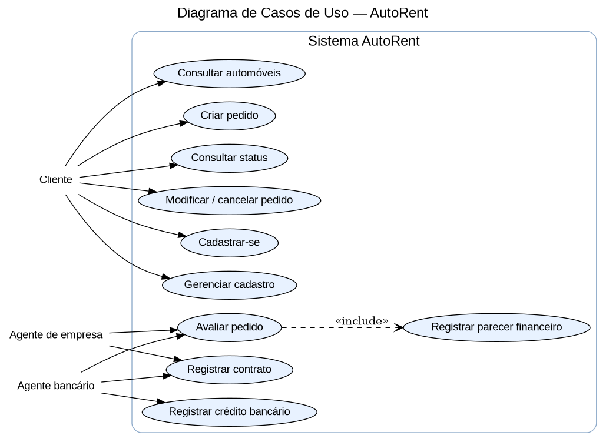
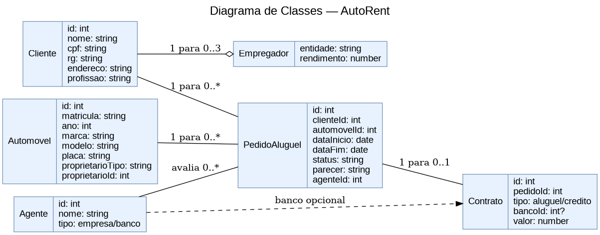
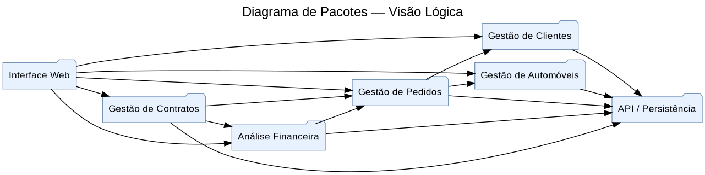
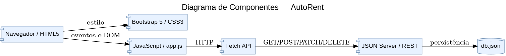

# AutoRent — Sistema de Aluguel de Carros

Projeto desenvolvido para o LAB02 de DIW.

## Histórias de Usuário e Requisitos

[Visualizar histórias de usuário e requisitos](AutoRent/modelagem/historias_requisitos.md)

## Diagrama de Casos de Uso

## Diagrama de Classes

## Diagrama de Pacotes

## Diagrama de Componentes

## Código e documentação

[Acessar o projeto completo](AutoRent/)

[Instruções para executar o AutoRent](AutoRent/README.md)
